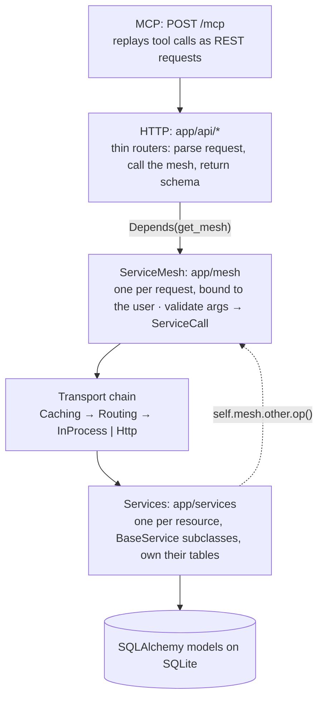

# Architecture

Detailed documents:

* [Service mesh](mesh.md): the mesh interface, transports, how to switch them, the microservices example, caching (with diagrams).
* [MCP support](mcp.md): `@mcp_tool`, the MCP server, OAuth 2.1 (with diagrams).

## Layers



Request flow for `GET /meetings/1` as Alice:

1. `get_current_principal` validates the JWT → `Principal(user_id=alice)`.
2. `get_mesh` builds `ServiceMesh(alice, CachingTransport(InProcessTransport(db)))` (or with a `RoutingTransport` to remote nodes, see [mesh.md](mesh.md#changing-the-transport)).
3. The router calls `mesh.meetings.get(meeting_id=1)`. The mesh validates the arguments against the operation's input model and sends a `ServiceCall` down the transport pipeline.
4. `MeetingsService.get` loads the meeting through `_visible()`, so it only finds it if Alice attends. Then it calls `mesh.notes.list(...)` and `mesh.tasks.list(...)` through the *same* mesh. Those services ask `mesh.meetings.access(...)` before returning anything.

## Services

* `BaseService` holds the DB session, the `principal` and the `mesh`, plus shared helpers (`_get_visible`, `_apply`, `_save`, `_delete`).
* Every service implements `_visible()`: a query restricted to rows the principal may read. Every read goes through it. That gives each service a single place where privacy is enforced.
* Services never import each other. Anything outside their own tables goes through `self.mesh.<service>.<op>(...)`. The meetings service owns attendance (`meeting_users`) and invitations (`meeting_invitations`), so it is the authority the other services ask about access, through internal operations (`access`, `accessible_ids`, `co_attendee_ids`, `pending_inviter_ids`). It doesn't read `User` rows either: attendee profiles come from `mesh.users.list()`, so they follow each user's sharing settings.
* Services return Pydantic schemas, never ORM objects. That makes results safe to cache, safe to send over a wire, and unable to lazy-load data the user shouldn't see.
* Registration and login (`app/auth/service.py`) are deliberately **not** mesh services: they run before a user exists, and the mesh is per-user.

## Decorators and LLM tools

```python
@service("tasks")                         # registers the class with the mesh
class TasksService(BaseService):
    @query(depends_on=("meetings",))      # read: cacheable, tagged
    def list(self, meeting_id: Optional[int] = None, status: Optional[TaskStatus] = None) -> List[schemas.Task]:
        """List tasks due at the meetings you attend..."""   # becomes the tool description

    @command                              # write: invalidates cached reads
    def create(self, data: schemas.TaskCreate) -> schemas.Task: ...

    @query(tool=False)                    # routable between services, hidden from LLMs
    def ...
```

At registration, the method signature becomes a Pydantic input model and the return annotation becomes a `TypeAdapter`. The same metadata serves four purposes:

| Use | Built from |
|---|---|
| Argument validation on every call | input model |
| `mesh.get_tools()`: `{name, description, input_schema}` (Anthropic tool format) | input model JSON schema + docstring |
| `mesh.execute_tool(name, args)`: runs an LLM tool call as the user, returns JSON | input model + result adapter |
| Cache and wire (de)serialization | result adapter |

`GET /tools/` and `POST /tools/{name}` expose these over HTTP.

## Mesh transports and caching

See [mesh.md](mesh.md). In short: the `ServiceMesh` is the interface services receive; *how* a call travels is a chain of `Transport`s (`CachingTransport`, `RoutingTransport`, `InProcessTransport`, `HttpTransport`) composed in `app/mesh/factory.py` from `MESH_REMOTE_SERVICES`. The query cache is `InMemoryCache` or, with `CACHE_URL=redis://...`, a `RedisCache` shared by every node. `InProcessTransport` is the default and holds the local service instances; `HttpTransport` reaches services running on another node through `POST /mesh/{service}/{operation}`. `docker-compose.microservices.yml` runs the app as two nodes.

## MCP server and OAuth

See [mcp.md](mcp.md). Endpoints marked `@mcp_tool` are published at `POST /mcp` (Streamable HTTP, stateless); tool calls are replayed as in-process REST requests for the signed-in user. `/mcp` only accepts access tokens from the OAuth 2.1 server in `app/oauth/` (discovery, dynamic registration, PKCE, rotating refresh tokens with reuse detection).

## Privacy rules

| Resource | Read | Create | Update / delete |
|---|---|---|---|
| User | yourself (full account), users sharing a meeting with you and owners of meetings you have a pending invitation to (email, plus name if they share it) | public registration | yourself (`share_name`) |
| Meeting | attendees | any user (becomes owner + attendee) | owner only |
| Invitation | the owner of its meeting; the invitee while it is pending (title, time and who invited them) | meeting owner, by email | invitee accepts or declines; owner revokes (unless accepted) |
| Attendance | attendees of the meeting | accepting an invitation | owner removes anyone; an attendee removes themselves (leaves) |
| Note | attendees of its meeting | attendees | — (no endpoints) |
| Task | attendees of its meeting | attendees | task creator or meeting owner; moving it requires attending the target meeting |

* Anything you can't read returns **404**, never 403, so ids can't be probed. 403 means "you can see it but can't change it".
* Removing an attendee revokes their access immediately, including any cached reads.

### Invitations and profile sharing

Users join meetings only by accepting an invitation. Before this, the owner listed `attendee_ids`: anyone could add sequential ids to a meeting and, being co-attendees, read those users' profiles without their consent.

* The owner invites **emails**, not ids. An invitation grants nothing; accepting it creates the `meeting_users` row. Declining is final; the owner can revoke and invite again.
* Inviting never resolves the email to a user and always answers the same way, so it can't be used to discover who is registered. The owner sees only the email they typed and its status.
* Pending invitees are visible only to the owner, not to the other attendees.
* The invitee sees the meeting's title and time and who invited them; description, attendees, notes and tasks only after accepting.
* Other users see a `UserProfile`: the email always, the name only if its owner set `share_name` (`PUT /users/me`, off by default). `GET /users/me` returns the full account.
* Any attendee can leave (`DELETE /meetings/{id}/attendees/{own id}`), which withdraws consent and access at once.

Known limits, not addressed here:
* Emails are not verified. Someone who registers with an address they don't own would see invitations sent to it and could accept them. Fixing this needs email verification (sending mail), which is out of scope.
* `POST /users/` answers 409 for a registered email, so registration can still be used to check whether an address has an account. The usual fix also relies on email verification ("check your inbox" for both cases).
* A declined invitation can only come from a registered account, so the owner learns that the invitee's email is registered. They still learn nothing else about that account.

## Authentication

* `POST /users/` registers. Emails are lower-cased; passwords are hashed with PBKDF2-SHA256 (stdlib, 600k iterations).
* `POST /auth/token` (OAuth2 password form, `username` = email) returns an HS256 JWT. Swagger's **Authorize** button works with it.
* Unknown emails still run a hash comparison, so response timing doesn't reveal which accounts exist.
* Set `SECRET_KEY` in any persistent deployment. Without it a random key is generated, and tokens stop working when the server restarts.

## Model changes

| Change | Why |
|---|---|
| `User.hashed_password`, `User.created_at` | Authentication |
| `oauth_clients`, `oauth_authorization_codes`, `oauth_grants`, `oauth_refresh_tokens` | MCP OAuth: registered clients, single-use codes, one grant per sign-in (the revocation unit), rotating refresh tokens. Only hashes of codes, secrets and tokens are stored |
| `meeting_users` mapped as `MeetingAttendee` (same table) | The meetings service manages attendance by id, without loading `User` rows from another service's domain; room for per-attendee data (RSVP, role) |
| `Meeting.owner_id` | Someone has to be allowed to edit or delete; attendees can't all have equal rights |
| `Note.author_id`, `Task.created_by_id` | Accountability, and the task permission rule |
| `TaskStatus` enum (`pending`/`completed`/`cancelled`) | `status` was a free-form string; it is now validated by the API and the DB column |
| Tasks cascade-delete with their meeting; `ON DELETE CASCADE` FKs; `PRAGMA foreign_keys=ON` | `Task.due_meeting_id` is non-nullable, so deleting a meeting with tasks used to fail. SQLite ignores FKs unless the pragma is enabled |
| Indexes on `meeting_id`, `due_meeting_id`, owner/author columns, `meeting_users.user_id` | Every visibility query filters on these columns |
| `PartialUpdate` schemas reject explicit `null` for required fields | `{"title": null}` used to reach the DB as a NOT NULL violation |
| `meeting_invitations` (`MeetingInvitation`: email, `InvitationStatus`, `user_id` once accepted); `MeetingCreate.attendee_ids` and `MeetingUpdate.attendee_ids` removed | Join by consent instead of being added by id (see [Invitations and profile sharing](#invitations-and-profile-sharing)) |
| `User.share_name` (default `false`); the ORM `Meeting.attendees` / `User.meetings` relationships removed | What others see of you is your choice; meetings can no longer serialize `User` rows behind the users service's back |

Possible next steps, not implemented:
* Alembic migrations. Tables are currently created at startup, so after a schema change an existing `meetings.db` has to be deleted (or altered by hand, e.g. `ALTER TABLE users ADD COLUMN share_name BOOLEAN DEFAULT 0 NOT NULL`).
* Email verification (see the known limits above).
* `Task.assignee_id`.
* Timezone-aware datetimes.
* Note editing.
