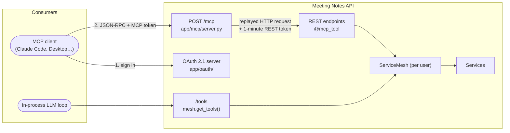
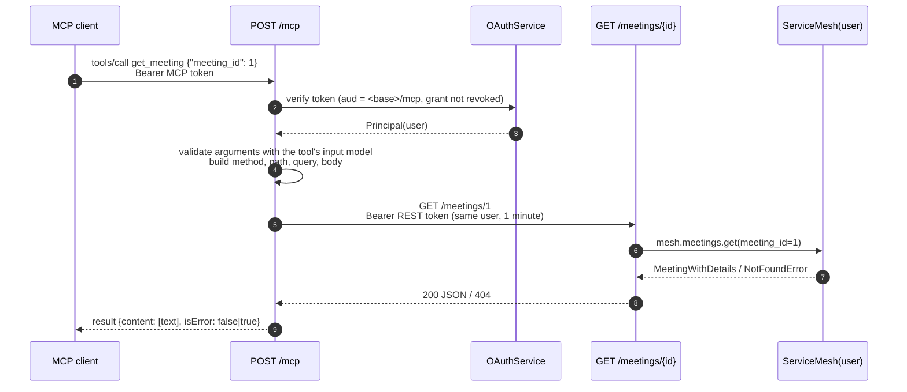
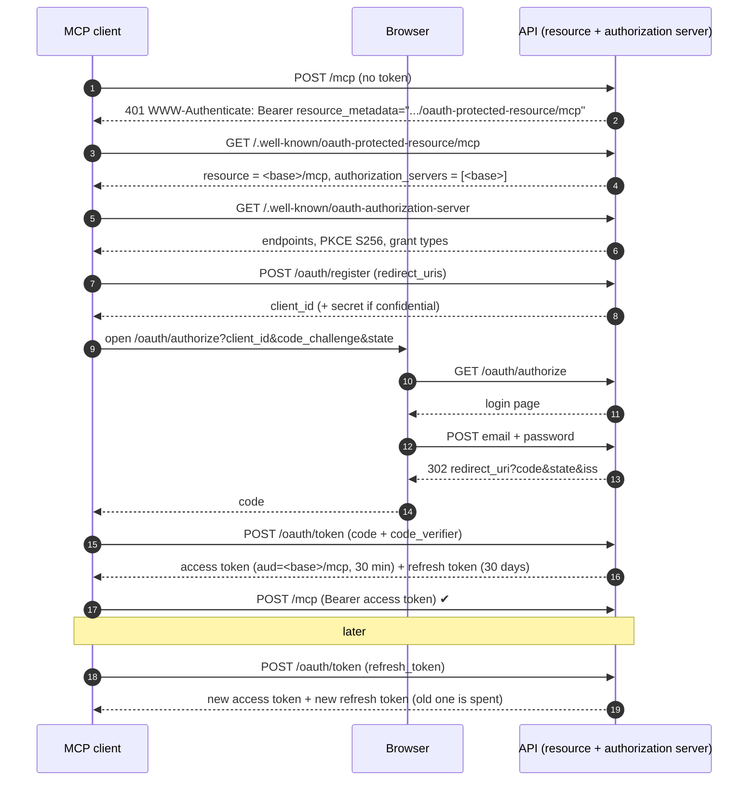
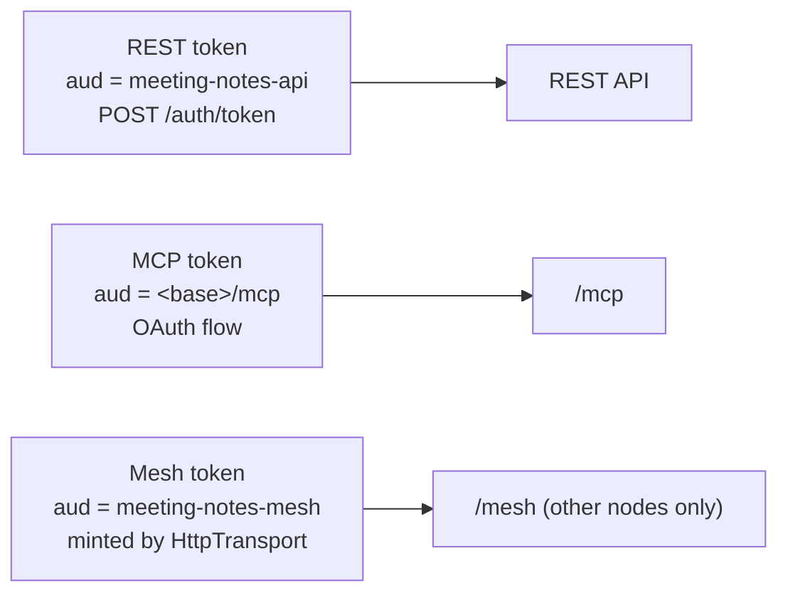

# MCP support

The API is also an [MCP](https://modelcontextprotocol.io) server, so agents and chat clients (Claude Code, Claude Desktop, any client with OAuth support) can use it as tools. Each tool call runs as the user who signed in for that connection, with the same validation and privacy rules as the REST API.

## Two tool layers

The project exposes tools at two levels. They are complementary:

| | Mesh tools | MCP tools |
|---|---|---|
| Declared with | `@query` / `@command` on service methods | `@mcp_tool` on endpoint functions |
| Granularity | Service operations (`meetings_get`) | HTTP endpoints (`get_meeting`) |
| Exposed by | `mesh.get_tools()` / `execute_tool()`, `GET/POST /tools` | `POST /mcp` (MCP protocol) |
| Consumer | Code that embeds an LLM in-process (Anthropic tool format) | External agents and chats |
| Auth | The mesh's user | OAuth 2.1 (below) |



## Publishing an endpoint as a tool

`@mcp_tool` (`app/mcp/registry.py`) only marks the function. It goes under the route decorator:

```python
@router.get("/{note_id}", response_model=schemas.Note)
@mcp_tool                      # or @mcp_tool(name=..., title=..., description=...)
def get_note(note_id: int, mesh: ServiceMesh = Depends(get_mesh)):
    """Get a specific note by ID."""   # becomes the tool description
```

On the first `tools/list`, `endpoint_tools(app)` walks `app.routes` and, for every marked `APIRoute`, reads what FastAPI already parsed: method, path, path/query/body parameters (`get_flat_dependant`). From that it builds one Pydantic input model per tool. The model is the tool's `inputSchema` and validates incoming arguments. The tool can't drift from the route, because it is derived from it.

17 endpoints are published. Login, `/tools` and `/` are not.

## The server

`app/mcp/server.py` implements the MCP **Streamable HTTP** transport, stateless and with JSON responses:

* `POST /mcp` takes one JSON-RPC message and implements `initialize`, `ping`, `tools/list` and `tools/call`. Notifications get `202`.
* `GET` and `DELETE /mcp` answer `405`: there is no server-initiated SSE stream and no session to close.
* Requests with a non-local `Origin` header are rejected (DNS-rebinding protection, required by the spec).
* Every request, `tools/list` included, needs an MCP access token.

The official `mcp` SDK isn't used on the server because it requires `pydantic>=2.12`, while the project pins 2.5.3. The behaviour was checked against the official SDK client.

### How a tool call runs

`tools/call` doesn't call the endpoint function directly. It replays the call as an HTTP request against the same app, in-process (`httpx.ASGITransport`):



* Because the call goes through the real route, validation, the service mesh and the privacy rules apply exactly as for any REST client.
* The MCP token isn't valid for the REST API (different audience), so the server mints a one-minute REST token for the same user.
* HTTP errors (403, 404, 422) come back as tool results with `isError: true`, so the model can read them and correct itself.
* The body is sent with `exclude_unset`, so partial updates stay partial.

## Authorization (OAuth 2.1)

`app/oauth/` is a small authorization server implementing the [MCP authorization spec](https://modelcontextprotocol.io/specification/2025-11-25/basic/authorization). MCP clients get their own sign-in flow and a long-lived session, without any long-lived bearer token.



| Piece | Decision |
|---|---|
| Grants | `authorization_code` with **PKCE S256 required**, plus `refresh_token`. No implicit or password grant. |
| Clients | Dynamic registration (RFC 7591). Public (`none`) and confidential (`client_secret_post` / `client_secret_basic`, secret stored hashed) clients. Redirect URIs must be https, http on loopback (any port, RFC 8252), or a private-use scheme. |
| Login page | Server-rendered HTML (`templates/login.html`), escaped output, `X-Frame-Options: DENY`. Client and redirect URI are validated before anything is shown or redirected (no open redirect), and every POST re-validates the hidden fields. |
| Access token | JWT, `aud` = MCP resource URL, `sid` = grant id, TTL `MCP_ACCESS_TOKEN_TTL_MINUTES`. `/mcp` checks the audience and that the grant isn't revoked, so revocation takes effect immediately. |
| Refresh token | Opaque, SHA-256 hashed, TTL `MCP_REFRESH_TOKEN_TTL_DAYS`, rotated on every use, bound to its client. **Reusing a spent token revokes the whole grant** (RFC 9700 §4.14.2). |
| Codes | Opaque, hashed, single-use (consumed even if the exchange fails), 5 minutes, bound to client, redirect URI and PKCE challenge. |
| Revocation | `POST /oauth/revoke` (RFC 7009) revokes the grant: its refresh tokens and live access tokens. |

The issuer, resource and audience URLs come from `PUBLIC_BASE_URL`, or from the request's base URL when it isn't set.

### Token audiences

Each kind of token is accepted only where it belongs:



### Not implemented

A consent screen separate from login, remembered browser sessions (you sign in each time you authorize a client), Client ID Metadata Documents, rate limiting of the login form, and cleanup of spent refresh tokens.

## Connecting a client

```bash
claude mcp add --transport http meetings-api http://localhost:8000/mcp
```

Then run `/mcp` in Claude Code and choose **Authenticate**. The browser opens the API's login page: sign in with a registered user (see the README's *Getting started*). The client stores the tokens and refreshes them on its own. Behind a proxy or on another host, set `PUBLIC_BASE_URL` (e.g. `https://api.example.com`).

## Tests

`tests/test_mcp.py` covers the protocol and tool calls; `tests/test_oauth.py` drives the real OAuth flow (discovery, registration, login page, PKCE, rotation, reuse detection, revocation) through the `oauth_login()` and `ApiUser.mcp_headers` helpers in `tests/conftest.py`.
