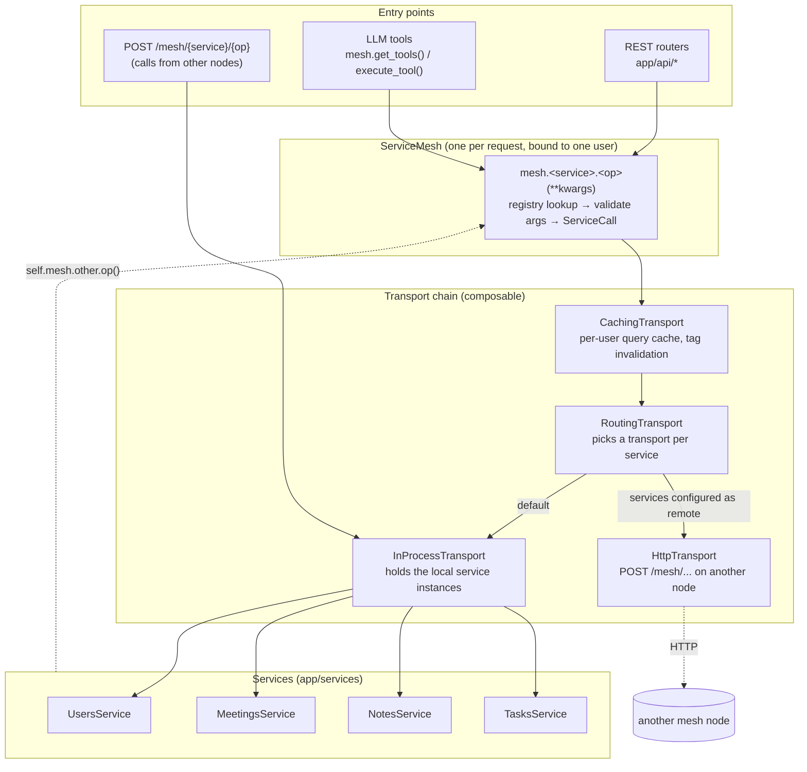
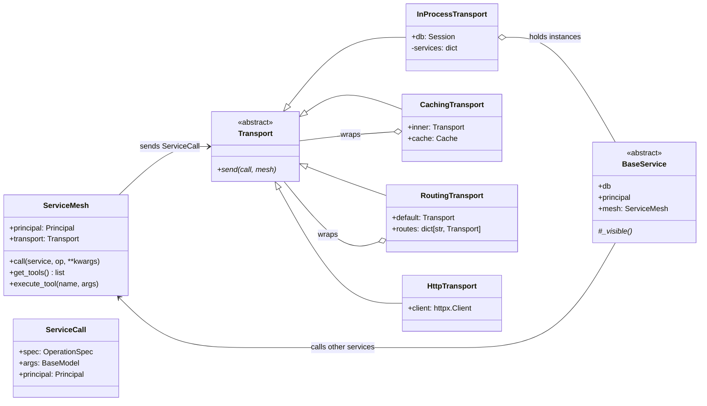
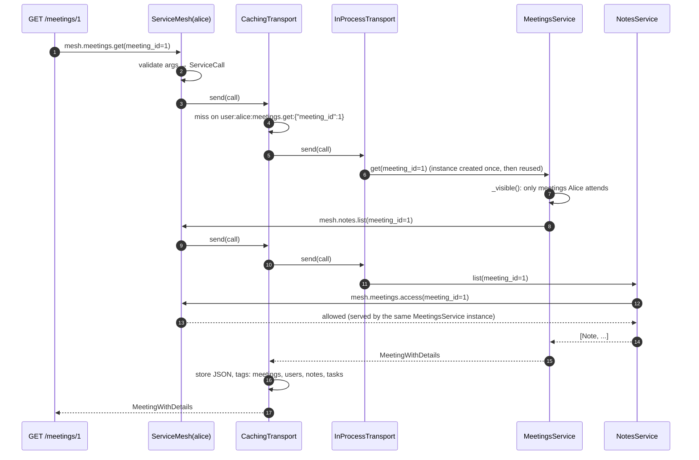
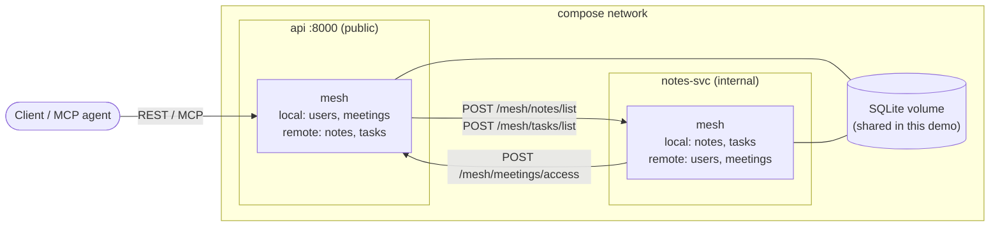
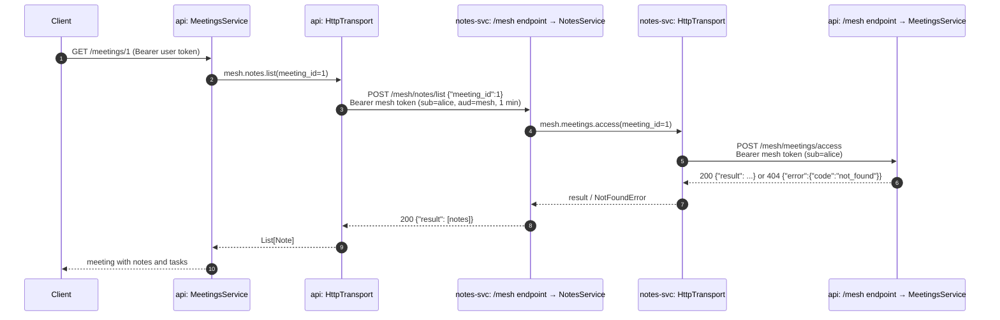
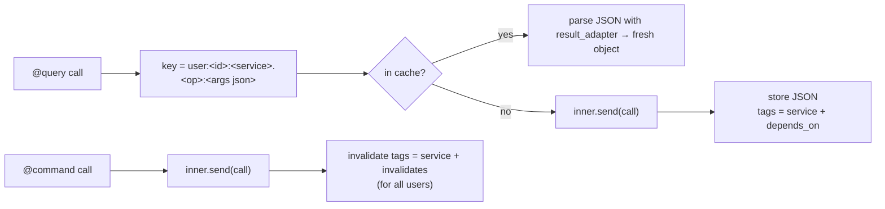

# Service mesh

The mesh is how services talk to each other. Every service receives a `ServiceMesh` (the interface) and reaches any other service only through it: `self.mesh.meetings.access(meeting_id=1)`. Services never import, instantiate or hold references to each other.

The design separates two concerns that change for different reasons:

| | Responsibility | Changes when… |
|---|---|---|
| **`ServiceMesh`** (`app/mesh/mesh.py`) | *What* is called and *on whose behalf*: service directory, the user (`Principal`), argument validation, `get_tools()` / `execute_tool()` | never per deployment |
| **`Transport`** (`app/mesh/transports.py`) | *How* the call travels: in memory, cached, over HTTP, (gRPC…) | the deployment changes |

Transports share one method, `send(call, mesh)`, and wrap each other. A deployment is a composition of transports, chosen in `app/mesh/factory.py` from configuration. Switching from a monolith to microservices changes configuration only: neither the services nor the mesh change.

## Components



The dotted arrow from the services back to the mesh is the key rule: a service that needs another service goes back through the mesh, so the call gets the same validation, caching, user scoping and routing as any other call.

## Classes



* **`InProcessTransport`** is the default implementation. It creates each service on first use, bound to the DB session, the user and the mesh, and keeps the reference for later calls in the same request.
* **`CachingTransport`** and **`RoutingTransport`** are decorators: they add behaviour and delegate to the transport they wrap.
* **`HttpTransport`** is the remote implementation: it serializes the call and sends it to the node that runs that service.

## Declaring operations

```python
@service("tasks")                          # registers the class with the mesh
class TasksService(BaseService):
    @query(depends_on=("meetings",))       # read: cached, tagged "tasks" + "meetings"
    def list(self, meeting_id: Optional[int] = None) -> List[schemas.Task]:
        """List tasks due at the meetings you attend."""   # → LLM tool description
        ...

    @command                               # write: invalidates the "tasks" tag
    def create(self, data: schemas.TaskCreate) -> schemas.Task: ...
```

From each signature the registry builds an input model (validation and the LLM tool `input_schema`) and a result adapter (cache and wire serialization). `@query(tool=False)` keeps internal operations, such as `meetings.access`, routable between services but hidden from `get_tools()`.

## A call, end to end (everything in memory)

`GET /meetings/1` as Alice, default configuration:



## Changing the transport

### 1. By configuration: run some services elsewhere

`MESH_REMOTE_SERVICES` lists the services this process reaches over HTTP, as `service=url` pairs. Services not listed run in memory.

| `MESH_REMOTE_SERVICES` | Composition built by `factory.build_transport` |
|---|---|
| *(empty, default)* | `Caching → InProcess` |
| `notes=http://notes-svc:8000,tasks=http://notes-svc:8000` | `Caching → Routing(default=InProcess, notes=Http(notes-svc), tasks=Http(notes-svc))` |

Every node runs the same image and exposes `POST /mesh/{service}/{operation}`, so any node can serve any service: the configuration decides who serves what. Related settings: `MESH_REMOTE_TIMEOUT_SECONDS` (10). All nodes must share `SECRET_KEY`.

### 2. In code: compose transports by hand

```python
from app.mesh.transports import CachingTransport, HttpTransport, InProcessTransport, RoutingTransport

transport = CachingTransport(
    RoutingTransport(
        default=InProcessTransport(db),
        routes={"notes": HttpTransport(httpx.Client(base_url="http://notes-svc:8000"))},
    ),
    cache=RedisCache(...),      # any Cache implementation
    ttl_seconds=300,
)
mesh = ServiceMesh(principal, transport)
```

Tests use this to insert a `RecordingTransport` that records which calls cross the mesh (`tests/test_mesh.py`).

### 3. A new communication mode (e.g. gRPC)

Implement one class and route services to it:

```python
class GrpcTransport(Transport):
    def __init__(self, channel):
        self.stub = MeshStub(channel)

    def send(self, call: ServiceCall, mesh: ServiceMesh) -> Any:
        reply = self.stub.Call(MeshRequest(
            service=call.spec.service, operation=call.spec.name,
            args_json=call.args.model_dump_json(exclude_unset=True),
            token=create_access_token(call.principal.user_id, audience=MESH_AUDIENCE, ttl_minutes=1)))
        if reply.error_code:
            raise ERRORS_BY_CODE[reply.error_code](reply.error_message)
        return call.spec.result_adapter.validate_json(reply.result_json)
```

The server side calls `factory.serve_call(principal, db, service, operation, args)`, the same function the HTTP endpoint uses. The rules every remote transport follows:

* **Arguments** are sent with `exclude_unset=True`, so partial updates stay partial.
* **Results** are serialized and parsed with the operation's `result_adapter`. That is why services return Pydantic schemas, never ORM objects.
* **Errors** travel as `{code, message}` and are re-raised as the same `ServiceError` subclass (`ERRORS_BY_CODE`). A 404 on the remote node is a `NotFoundError` on the caller.
* **Identity** travels as a credential, never as a bare user id (next section).

## Remote calls: the microservices example

`docker-compose.microservices.yml` splits the app into two nodes of the same image:



```bash
SECRET_KEY=$(openssl rand -hex 32) \
  docker compose -f docker-compose.yml -f docker-compose.microservices.yml up --build
```

`GET /meetings/1` now crosses the network twice, and the services involved are the same code as in the monolith:



### Identity between nodes

* `HttpTransport` signs a JWT for the caller with `aud=meeting-notes-mesh` and a one-minute lifetime. The receiving node runs the operation as that same user, so the privacy rules apply on every node.
* `/mesh` accepts only that audience. REST and MCP tokens are rejected (401), and no user-facing endpoint issues mesh tokens.
* Internal operations (`meetings.access`, `accessible_ids`…) are reachable through `/mesh`, because other nodes need them. In production, keep `/mesh` on an internal network or port, or add mTLS between nodes.

### Simplifications of the example

* **Shared database.** Both nodes use the same SQLite volume. Real microservices would each own their tables (the services already only touch their own tables, so the split is possible).
* **Cache coherence.** The cache sits on the caller's side of the chain, and each process has its own `InMemoryCache`. A command run on one node can't invalidate entries cached on the other, so the example sets `CACHE_TTL_SECONDS=0`. A shared `Cache` implementation (e.g. Redis, where `invalidate_tags` reaches every node) restores caching.
* **Failures.** A refused connection, timeout or malformed answer becomes `ServiceUnavailableError` (HTTP 503). There are no retries or circuit breakers.

## Caching



* Entries are per user, so one user's cached result is never served to another.
* A query is tagged with its service plus `depends_on`. `notes.list` depends on `meetings`, because attendance decides which notes are visible.
* Invalidation is global across users: Alice editing a meeting changes what Bob may see, and removing an attendee revokes their cached reads at once.
* Known limitation: a read that races a concurrent write can cache a stale value until the TTL expires (`CACHE_TTL_SECONDS`, default 300). Versioned tags would close this gap.

## Testing the transports

* Every API test runs twice (`tests/conftest.py`): once in memory (`local`) and once with **every** service behind `HttpTransport` (`http`). In `http` mode the "remote node" is the same app reached through real HTTP requests in-process, so each cross-service call goes through serialization, `/mesh` and the mesh token. If something works in `local` but fails in `http`, it isn't wire-safe.
* `tests/test_mesh.py` covers instance reuse, routing, results and errors across HTTP, partial updates, unreachable nodes and token audiences.
